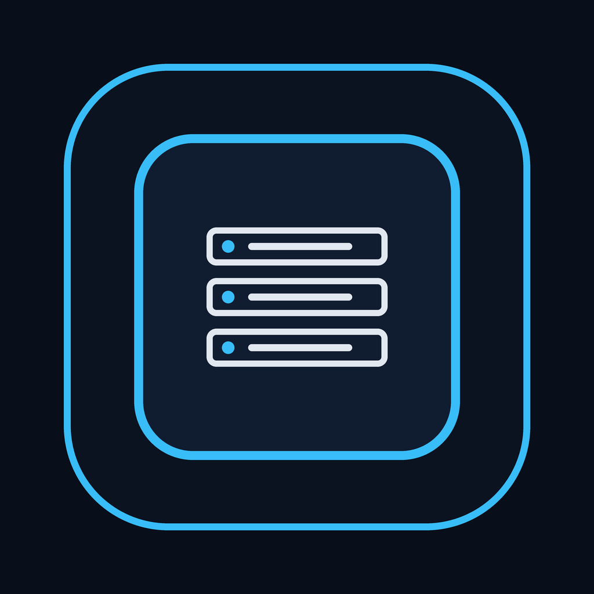

# Server Manager

<p align="center">
  
</p>

<p align="center">
  <a href="LICENSE.txt"></a>
  <a href="https://github.com/Wind134/MaidKit/actions/workflows/build.yml"></a>
  <a href="README_ZH.md">简体中文</a>
</p>

## About this repository

This is an **independently maintained fork** of [Solsynth/MaidKit](https://github.com/Solsynth/MaidKit). The original program was created by LittleSheep and the Solsynth contributors and released under the GNU Affero General Public License v3.0.

This fork keeps the original copyright notices and the full `LICENSE.txt` intact, and every change made here stays under AGPL-3.0. Attribution to the original authors and contributors is preserved in the source and in this document.

What is different from upstream:

- Update checks and downloads now point to **this repository's** GitHub Releases
- CI builds and publishes Windows, Linux and Android installers when a tag is pushed
- Windows and Linux artifacts follow the `server_manager_{version}` naming rule; Android keeps per-architecture APKs
- A flat, tech-oriented icon set is applied to every platform
- An unreliable external git dependency is vendored as `packages/island_ui_foundation`
- Android builds fall back to unsigned APKs when no signing secrets are configured
- CI pins Flutter 3.47.9 to match the repository's Gradle / AGP versions

## What it does

A cross-platform server operations tool. Everything is done over SSH, so no agent software needs to be installed on the managed machines.

### Servers and terminal

- Server cards with grouping, tags, sorting and custom environment variables, showing load, memory and uptime
- Live CPU, memory, network and disk charts
- SSH terminal with split panes, draggable tabs, a command palette and multiple color schemes

### Files and system administration

- Dual-pane SFTP browser with drag-and-drop transfers, an inline editor and file-operation shortcuts
- Process inspection and termination, systemd unit management
- nginx and Caddy configuration editing, crontab editing
- Package management (apt, dnf and others)
- Firewall management (UFW, firewalld, nftables, iptables)
- Local and remote port forwarding
- Per-server HTTP CONNECT or SOCKS5 proxy support
- Embedded Tailscale node, so no separate client is required

### Containers and deployment

- Docker and Podman container operations: start, stop, restart, pause, kill, remove
- Compose project grouping with service status, merged logs and lifecycle actions
- Image management and runtime installation assistance
- Deployment project catalog that groups compose stacks, web servers and containers, with TOML import/export

### Scripts, AI and integrations

- Reusable shell snippets that run on one or several connected servers with streamed output
- A built-in AI agent that operates servers through tools, with your own provider or Solar Network AI
- MCP servers and reusable skills extend the agent; proposed actions require approval before execution
- GitHub device-flow sign-in for repositories, workflows, pull requests and releases
- A local MCP server exposing your SSH servers, snippets and skills to other agents on the machine

### Security and preferences

- Credentials stored in an AES-GCM 256 encrypted vault, with PBKDF2 key derivation (310,000 iterations)
- Biometric unlock, encrypted backup archives (`.mkb`) and optional encrypted cloud sync
- Theme, accent color, workspace background and English / Simplified Chinese interface
- Terminal renderer choice (libghostty-vt / xterm), font and color scheme
- Connect on startup, hide addresses while screen sharing, metrics refresh intervals and Tailscale settings

## Getting started

### Requirements

- Flutter SDK **3.47.9** (the version used by CI, matching Gradle 8.14 / AGP 8.12)
- Windows development requires [NASM](https://www.nasm.us)
- Linux development needs `ninja-build`, `libgtk-3-dev`, `libayatana-appindicator3-dev`, `keybinder-3.0`, `libnotify-dev` and related packages

### Run

```bash
flutter pub get
flutter run
```

After changing route annotations or Drift schemas:

```bash
dart run build_runner build --delete-conflicting-outputs
```

Before committing:

```bash
dart format lib test
flutter analyze
flutter test
```

### Build installers

```bash
# Windows
flutter build windows --release

# Linux -> server_manager_<version>.AppImage
flutter build linux --release
bash buildtools/build-appimage.sh

# Android
flutter build apk --release --split-per-abi
```

## Releases and updates

Pushing a tag such as `1.0.0` triggers `.github/workflows/build.yml`: all three platforms build in parallel, then a GitHub Release is created and the installers are uploaded.

- Windows: `server_manager_<version>.exe`
- Linux: `server_manager_<version>.AppImage`
- Android: `app-<arch>-release.apk`

The client checks `api.github.com/repos/Wind134/MaidKit/releases/latest`, so publishing a newer tag is enough to notify existing users.

> Android packages are currently unsigned. To enable signing, add `ANDROID_KEYSTORE_BASE64`, `ANDROID_KEY_ALIAS` and `ANDROID_KEYSTORE_PASSWORD` to the repository secrets; the pipeline will pick them up automatically.

## Code layout

Feature code lives directly under `lib/<feature>/` without extra `presentation` / `domain` / `data` layers.

| Area | Technology |
|------|------------|
| UI | Flutter + Material 3 |
| State | hooks_riverpod |
| Navigation | auto_route |
| Storage | Drift (SQLite) |
| SSH | dartssh2 |
| Cryptography | AES-GCM / PBKDF2 |
| Terminal | libghostty-vt / xterm |
| Desktop | window_manager + island_ui_foundation |

See [docs/architecture.md](./docs/architecture.md) for the full architecture guide.

## License and attribution

Released under the [GNU AGPL-3.0](./LICENSE.txt). Original copyright belongs to LittleSheep, Solsynth and the original contributors; changes in this fork are licensed under the same terms.

The license covers source code only. The upstream project name, logo and branding may be subject to separate licenses or trademark rights.
