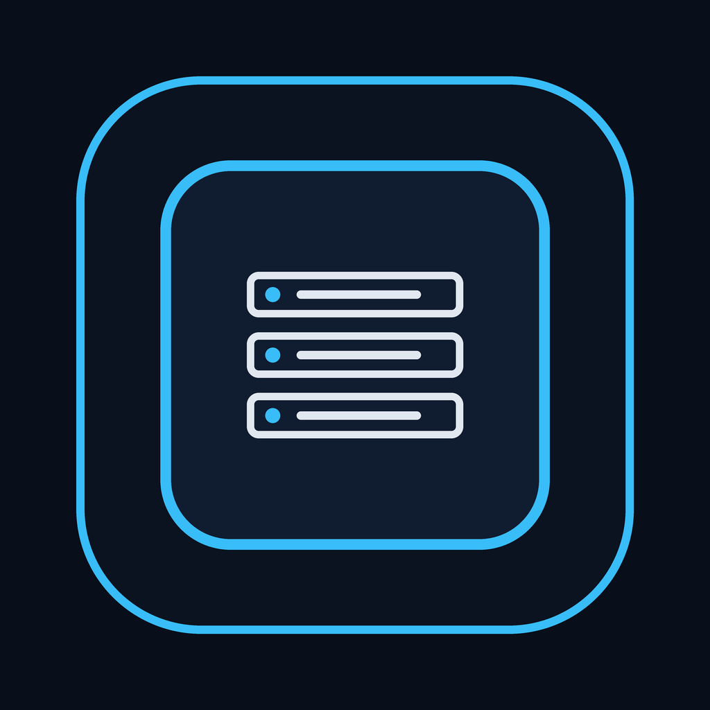

# Server Manager

<p align="center">
  
</p>

<p align="center">
  <a href="LICENSE.txt"></a>
  <a href="https://github.com/Wind134/MaidKit/actions/workflows/build.yml"></a>
</p>

## 项目来源

本仓库是 [Solsynth/MaidKit](https://github.com/Solsynth/MaidKit) 的**独立维护分支**。原始程序由 LittleSheep 与 Solsynth 贡献者创作，并以 GNU AGPL-3.0 协议发布。

本分支在完整保留原版权声明与 `LICENSE.txt` 的前提下进行二次修改和持续维护，所有改动同样遵循 AGPL-3.0。原始作者与贡献者的署名在源码和文档中继续保留。

相对上游，本分支目前的区别：

- 更新检查与安装包下载全部改为读取**本仓库**的 GitHub Releases
- 流水线在推送 tag 时自动构建并发布 Windows、Linux、Android 三端安装包
- Windows 与 Linux 产物按 `server_manager_{version}` 命名，Android 保留分架构 APK
- 更换了扁平科技风图标，并同步生成到 Android / iOS / Web / Windows / macOS / Linux
- 把访问不稳定的外部 git 依赖改为仓库内置的 `packages/island_ui_foundation`
- Android 在没有签名密钥时自动构建未签名包，避免 CI 配置阶段失败
- CI 固定 Flutter 3.47.9，以匹配仓库现有的 Gradle / AGP 版本

## 它能做什么

这是一个跨平台的服务器运维工具，核心操作全部走 SSH：不需要在目标服务器上安装代理程序，也不会引入额外的服务端口。

### 服务器与终端

- 服务器列表支持分组、标签、排序和自定义环境变量，卡片上直接显示负载、内存和运行时长
- 实时性能图表覆盖 CPU、内存、网络与磁盘
- SSH 终端支持分屏、标签拖拽、命令面板和多套配色方案

### 远程文件与系统管理

- 双栏 SFTP 文件浏览器，支持拖拽传输、内置编辑器以及常用文件操作快捷键
- 进程查看与结束、systemd 服务管理
- nginx / Caddy 配置编辑、计划任务（crontab）编辑
- 软件包管理（apt、dnf 等）
- 防火墙管理（UFW、firewalld、nftables、iptables）
- 本地与远程端口转发
- 可为单台服务器配置 HTTP CONNECT 或 SOCKS5 代理
- 内嵌 Tailscale 节点，无需在设备上另装 Tailscale 客户端

### 容器与部署

- 管理 Docker / Podman 容器：启动、停止、重启、暂停、终止和删除
- 按 Compose 项目分组，查看服务状态、合并日志和执行生命周期操作
- 镜像管理与运行时安装引导
- 部署项目目录，可把 Compose 栈、Web 服务和容器归组，并支持 TOML 导入导出

### 脚本、AI 与集成

- 保存可复用的 Shell 片段，并在一台或多台服务器上执行，输出和进度实时回传
- 内置 AI Agent，可通过工具操作服务器；支持自带模型服务或 Solar Network AI
- 支持 MCP 服务和可复用技能扩展 Agent 能力；敏感操作需要人工确认后才执行
- GitHub 设备流登录，可查看仓库、工作流、PR 和 Release，也可作为 Agent 工具使用
- 本地 MCP Server 可把已配置的 SSH 服务器、脚本和技能暴露给本机上的其他 Agent（如 Claude Desktop）

### 安全与设置

- 凭据保存在 AES-GCM 256 加密的本地保险库中，使用 PBKDF2（310,000 次迭代）派生密钥
- 支持生物识别解锁、加密备份（`.mkb`）以及可选的加密云同步
- 可配置主题、强调色、工作区背景、界面语言（简体中文 / English）
- 可选择终端渲染器（libghostty-vt / xterm）、字体和配色
- 支持启动即连接、投屏/录屏时隐藏服务器地址、指标刷新间隔、Tailscale 登录等设置

## 快速开始

### 环境要求

- Flutter SDK **3.47.9**（CI 使用的版本，与仓库的 Gradle 8.14 / AGP 8.12 匹配）
- Windows 开发需要 [NASM](https://www.nasm.us)
- Linux 开发需要 `ninja-build`、`libgtk-3-dev`、`libayatana-appindicator3-dev`、`keybinder-3.0`、`libnotify-dev` 等系统库

### 运行

```bash
flutter pub get
flutter run
```

修改路由注解或 Drift 表结构后需要重新生成代码：

```bash
dart run build_runner build --delete-conflicting-outputs
```

提交前建议执行：

```bash
dart format lib test
flutter analyze
flutter test
```

### 构建安装包

```bash
# Windows
flutter build windows --release

# Linux（产物名为 server_manager_<version>.AppImage）
flutter build linux --release
bash buildtools/build-appimage.sh

# Android
flutter build apk --release --split-per-abi
```

## 发布与更新

推送 `1.0.0` 这类 tag 会触发 `.github/workflows/build.yml`：三个平台并行构建，全部成功后创建 GitHub Release 并上传安装包。

- Windows：`server_manager_<version>.exe`
- Linux：`server_manager_<version>.AppImage`
- Android：`app-<架构>-release.apk`

客户端的更新检查指向 `api.github.com/repos/Wind134/MaidKit/releases/latest`，因此后续发布新 tag 即可让现有用户收到更新提示。

> 注意：当前 Android 安装包未使用正式签名。若要启用签名，请在仓库 Secrets 中配置 `ANDROID_KEYSTORE_BASE64`、`ANDROID_KEY_ALIAS` 和 `ANDROID_KEYSTORE_PASSWORD`，流水线会自动识别并生成签名包。

## 代码结构

功能代码平铺在 `lib/<feature>/` 下，没有额外的 `presentation` / `domain` / `data` 分层目录。主要依赖：

| 用途 | 技术 |
|------|------|
| 界面 | Flutter + Material 3 |
| 状态管理 | hooks_riverpod |
| 路由 | auto_route |
| 本地存储 | Drift (SQLite) |
| SSH | dartssh2 |
| 加密 | AES-GCM / PBKDF2 |
| 终端 | libghostty-vt / xterm |
| 桌面窗口 | window_manager + island_ui_foundation |

完整设计说明见 [docs/architecture.md](./docs/architecture.md)。

## 许可与归属

本项目以 [GNU AGPL-3.0](./LICENSE.txt) 发布。原始版权归 LittleSheep、Solsynth 及原项目贡献者所有；本分支的修改部分同样按 AGPL-3.0 授权。

AGPL 仅覆盖软件源代码。原项目的名称、Logo、图标和品牌材料可能适用单独的许可或商标权，不因本许可证自动获得授权。
